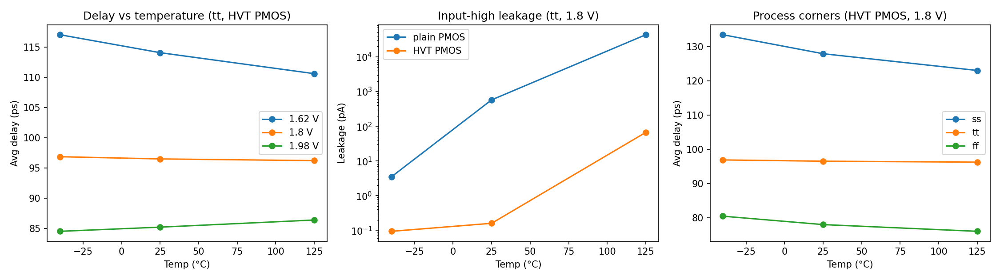

# Sky130 CMOS Inverter Characterization (ngspice)

Transistor-level characterization of a CMOS inverter (NMOS W/L = 0.42/0.15 µm, PMOS 0.84/0.15 µm, 10 fF load) on the SkyWater Sky130A PDK. The Python script sweeps 3 process corners (tt, ss, ff) x 3 supplies (1.62, 1.8, 1.98 V) x 3 temperatures (-40, 25, 125 °C), 27 corners in total, and extracts propagation delay, static leakage and average power.

Two PMOS variants are compared: the standard `pfet_01v8` and the high-threshold `pfet_01v8_hvt`.

## Key results (tt, 1.8 V, 25 °C)

| PMOS | Avg delay | Leakage (input high) |
|---|---|---|
| standard | 83.7 ps | 576 pA |
| high-Vt | 96.5 ps | 0.16 pA |

- High-Vt PMOS cuts input-high leakage by about 3,600x at 25 °C (about 650x at 125 °C), at about 15% more delay.
- Slowest corner (standard PMOS): ss, 1.62 V, -40 °C, about 138 ps. Fastest: ff, 1.98 V, about 61 ps.
- Temperature inversion: with the high-Vt PMOS at tt, average delay falls with temperature at 1.62 V, is nearly flat at 1.8 V, and rises at 1.98 V. At low supply the hottest corner is not the slowest.
- Leakage grows by orders of magnitude from -40 °C to 125 °C, and is largest at ff.

## Method
- `sweep.py`: generates an ngspice netlist per corner, runs it, parses `.meas` results, writes `results.csv`.
- `sweep_hvt.py`: same sweep with the high-Vt PMOS, writes `results_hvt.csv`.
- `plot.py`: produces `characterization.png`.
- `inv_tb.spice`: single-corner testbench.
- Delay is measured between 50% points of input and output. Leakage is the average supply current with the input held low or high. Average power is the mean supply current times Vdd.

## Notes and limits
- Simulator: ngspice 44, with `gmin=1e-15` to keep leakage readings above the numerical floor. Values below about 0.01 pA are near the solver tolerance.
- This is a single inverter with an ideal input and fixed load, not a full standard-cell library characterization with input slew and load tables.
- Paths in `sweep.py` are specific to my machine; edit `LIB` and `NGSPICE` at the top to reuse.

## Run

    python3 sweep.py
    python3 sweep_hvt.py
    python3 plot.py   # needs matplotlib and pandas
